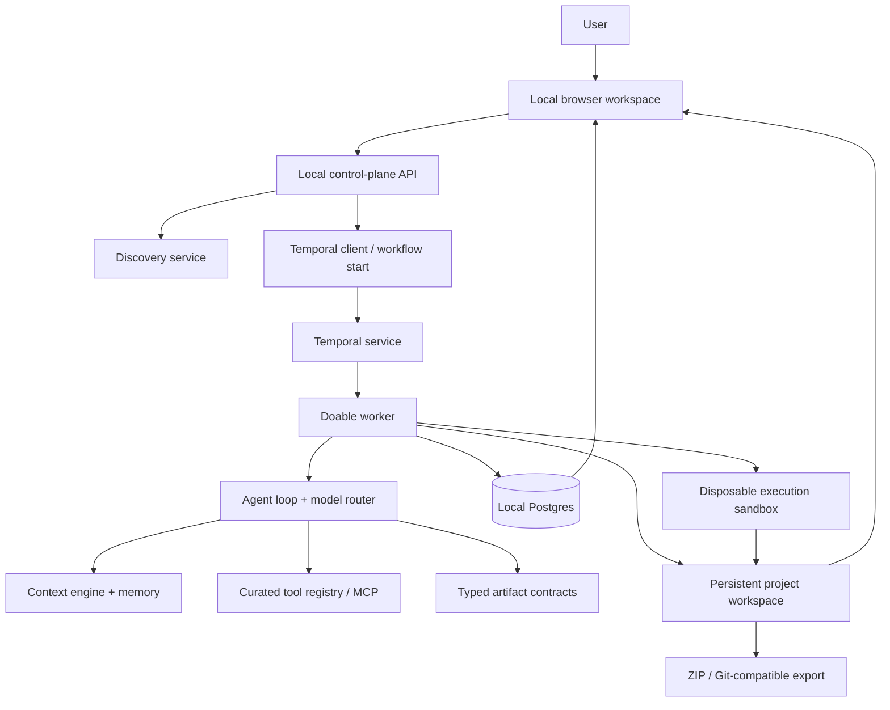
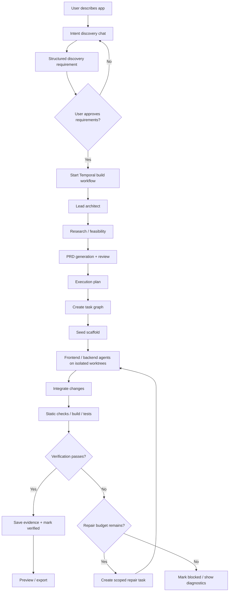

# Doable — V1.1 Architecture, Temporal Cutover & Local-First Product Build Plan

> **Status:** Implementation brief for the coding agent
> **Primary goal:** Turn Doable from an HCR prototype with competing orchestration paths into a reliable, open-source, local-first AI software-engineering runtime.
> **Execution model:** Inspect first, plan the migration, implement in reviewable phases, prove each phase with tests and an end-to-end golden path.
> **Product north star:** Idea → clarified requirements → architecture and plan → generated project files → verification → iterative repair, with durable state and human control.

---

## 0. Instructions to the implementation agent

You are implementing this plan inside the existing Doable repository. Do not treat this document as permission to rewrite everything from scratch.

1. **Inspect the actual checkout before changing anything.** Record `git status`, current branch, `git log -5 --oneline --decorate`, remote refs, and the exact commit being modified. Do not assume `main` is the newest source. Do not discard user changes or force-push.
2. **Read the repo guidance and architecture docs first:** `AGENTS.md`, `README.md`, `PHASE_4_PRD.md`, `PHASE_5.MD`, `JOB_6.MD`, `TEST_6.MD`, `TEMPORAL/`, `d-2/hcr/`, `d-3/agent_configuration/`, the Prisma schema/migrations, and this plan. Some paths may exist only on a feature branch; locate them instead of assuming.
3. **Inventory code paths before making edits.** Search for `inngest`, `node/execute`, `chat/requested`, `HCR_TRANSITION_MAP`, `startHCRWorkflow`, `hcrWorkflow`, `handleFailure`, `buildContext`, Inngest environment keys, workflow IDs, and all calls that start or mutate workflow/execution/node state.
4. **Use the existing full-graph Temporal implementation as the starting point.** The public `main` observed during planning contains a Temporal pilot at `app/api/temporal/pilot` and a separate Inngest-backed `/chat` production path. A fuller HCR Temporal workflow exists on a feature branch. Reconcile the current checkout and branches before deciding which work is already integrated.
5. **Build in small, verified phases.** Before editing, present a concise plan to the user/maintainer in the agent session. After each phase, run the relevant tests and summarize changed files, outcomes, remaining risks, and the next phase. Do not stop after writing a plan: implement the phases in this document unless a genuine blocker, destructive action, or missing credential prevents progress.
6. **Do not invent repo facts.** When a plan item conflicts with the checked-out code, the code and migration history win; explain the discrepancy and update this plan or a decision record.
7. **Preserve user data and compatibility.** Never reset the database, remove migrations, truncate project/files/artifacts, or drop schema elements without a migration and an explicit data-preservation plan.
8. **Do not expose private information.** Never log raw prompts, complete model inputs/outputs, API tokens, auth headers, database URLs, file contents, secrets, or PII. Log IDs, event types, durations, safe error codes and bounded/redacted summaries.
9. **Keep scope disciplined.** The near-term goal is a working local-first browser workspace and durable build loop. A desktop wrapper is a later packaging layer, not a reason to block the browser product. QA/repair/deploy are staged capabilities; never label an app “verified” unless an actual command/test succeeded.

---

## 1. Product definition

Doable is an **AI-native software-engineering runtime**, not just a chat interface or a prompt-to-code wrapper. It should take a user from an idea to a maintainable, inspectable, editable project through structured engineering execution.

The system should progressively support:

- clarifying user intent and constraints before implementation;
- turning discovery into explicit, versioned requirements;
- architecture, technical research, PRD, and execution-plan artifacts;
- narrowly scoped engineering agents that create real project files;
- durable workflow execution, retries, cancellation, resume/recovery, and traceability;
- context reconstruction from project history, artifacts, files, decisions, and failures;
- verification, bounded repair, and clear evidence for claims of correctness;
- portable local project storage and export, so users retain their code;
- transparent model configuration, privacy boundaries, and usage/cost controls.

### 1.1 Product principles

- **Reason before coding.** Discovery is an interactive process, not a one-shot form. Ask high-value follow-up questions based on ambiguity and likely impact; avoid repeatedly asking what the user has already specified.
- **Structured handoffs over agent chatter.** Agents are bounded execution roles with typed inputs/outputs and explicit transitions, not autonomous personalities that talk indefinitely.
- **Temporal owns durability and orchestration.** Doable owns agent reasoning, context assembly, routing policy, tool selection, prompts, memory, and product state. Temporal schedules and durably executes the workflow; it is not the intelligence layer.
- **Postgres and the project filesystem have clear responsibilities.** Postgres stores durable metadata, workflow records, messages, artifacts, events, configuration and indexes. Generated source files live in a real workspace directory managed by Doable. A workspace manifest and database metadata tie them together.
- **The sandbox is disposable.** A sandbox/container is an execution environment, not the canonical owner of work. The workspace and database are persistent. If a sandbox dies, discard/recreate it from persistent project files and re-run verification.
- **The user owns the output.** Users can inspect, edit, export and build on generated files without being locked into a hosted credit system.
- **Local-first, network-explicit.** App metadata, chat history, artifacts, settings and workspaces should remain on the user's machine by default. Only calls explicitly made to a remote inference provider or other enabled remote integration leave the machine.
- **Small, curated toolsets.** Discover/route tools before putting them into a model context; avoid feeding a huge irrelevant MCP catalog to every model call.
- **Budget-aware execution.** Have request/token/time/iteration limits, cancelability, and a user-visible estimate or confirmation when an operation could consume substantial resources.
- **Evidence over optimism.** Separate “generated”, “build passed”, “tests passed”, and “deployment succeeded”. A model statement is not a verification result.
- **Human control at consequential boundaries.** Require explicit user approval before destructive file operations, running untrusted generated code with broad host access, external publication, or deployment.

### 1.2 Intended user experience

The first supported interface is a browser-based local application: the user starts Doable on their computer and opens a local URL. The application should feel like a desktop workspace, not a public multi-tenant SaaS.

Later, package the same local product into a Linux/macOS desktop application if that materially improves startup, filesystem integration and lifecycle handling. Do not duplicate the application into separate web and desktop products. Prefer a shared UI and local backend, with a thin desktop shell only when the browser-based product is stable.

The target is an open-source tool people can install and configure with their own model provider or local model. Do not require Doable-hosted inference or a paid Doable account.

---

## 2. Verified starting point and caveats

Use these as investigation leads, not as claims about every branch:

- The attached `doable-v1-build-completion-plan.md` reports an artifact-driven HCR runtime, six cognitive nodes, versioned artifacts, runtime events, a discovery pipeline, context-engine and agent-configuration boundaries, and a completed Temporal full-graph implementation on the newest feature work it examined.
- The same plan reports the public `main` at commit `54d4507` at the time it was prepared, with the fuller work on `phase/hcr-context-engine`. The public repository branches should be rechecked because they can change.
- The public `main` tree observed for this brief has `app/api/temporal/pilot`, `src/temporal/` and `app/api/inngest/route.ts`, as well as `app/inngest/`. Its `app/api/projects/[id]/chat/route.ts` imports the Inngest client and sends `node/execute`. Its root README is still create-next-app boilerplate, and the branch's `AGENTS.md` references Next.js 15. Verify the actual working branch/version; do not blindly use these public-main snapshots if local work is newer.
- The feature-branch `src/temporal/workflows/hcrWorkflow.ts` inspected during planning orchestrates pending HCR nodes, uses Temporal activities with explicit timeouts/retries, delegates DB operations to activities and attempts failure compensation with `markHcrFailed`. It documents possible duplicate runtime events on retries and a joined fan-out loop where `wait` is considered unreachable. Review these assumptions and tests; do not preserve a known flaw merely for parity.
- The README under `src/temporal/` describes a local Temporal setup using `docker-compose.temporal.yml`, a worker script, and a pilot API route. Verify actual package scripts, compose configuration, task queue values, environment-variable names, and deployment mode before writing new docs.
- The attached plan reported 47 passing pure unit tests, `tsc` passing and lint errors/warnings at the time of its snapshot. Re-run the commands on the actual checkout and report the real result.

**Hard rule:** First create a branch/checkpoint or use a clearly named working branch after safeguarding current work. Never silently merge a feature branch, rewrite public history, or promote an unverified branch to `main`.

---

## 3. Target architecture



### 3.1 Layer responsibilities

**Control plane**
- Local UI, project navigation, discovery conversation, approvals, build timeline, artifacts, file tree/editor/viewer, settings, model-provider setup, logs and export.
- Validates user inputs and authorization/local ownership.
- Starts workflows through a single Temporal client/service boundary.
- Does not run long agent loops inside Next.js request handlers.

**Cognitive runtime**
- Discovery, context reconstruction, model routing, agent execution loop, curated tools/MCP, typed contracts, artifact production and event recording.
- Keeps all non-deterministic external activity—LLM calls, filesystem calls, network calls, DB writes—outside Temporal workflow code in activities.
- Each specialist receives a bounded task, relevant context and a strict output contract.
- Records meaningful decisions, handoffs, tool calls, cost/usage when available, duration, retry count, and verification evidence without storing raw secrets in logs.

**Durable orchestration**
- Temporal is the only workflow orchestrator for new builds, discovery completion where long-running, iteration, verification and repair.
- A workflow must be deterministic; call the outside world through activities. Treat workflow history/replay constraints seriously.
- Workflow IDs and business-level idempotency keys must be deterministic and documented. Enforce “one active build per project” or explicit bounded concurrency.
- Use signals/updates or well-defined child workflows for user approvals, cancellation, resume and repair-loop control where appropriate.
- Keep workflow inputs compact and serializable. Store large prompts/context in durable storage and pass references plus version/hash to the workflow where appropriate.
- Define task queues by actual workload/security boundary only when justified; document what runs on each queue.

**Persistent data plane**
- Postgres/Prisma holds projects, workflows, executions, nodes, artifacts, messages, project memory, runtime events, model profiles and provider configuration metadata as appropriate.
- Do not store provider secrets unencrypted in ordinary DB fields. Prefer local secret storage/environment configuration; if persisted, use OS-backed credentials/strong encryption with a documented threat model.
- A local filesystem workspace stores actual generated files. Store paths relative to a canonical project root and validate every operation to prevent traversal or symlink escapes.
- Never make a database row the only copy of a generated file. The user should be able to export the workspace even if Temporal is offline.

**Disposable execution layer**
- Use a per-run/per-project disposable sandbox for installs, builds, tests and browser automation.
- The sandbox has explicitly scoped read/write access to a workspace snapshot or worktree. It does not keep unique state that is required to resume.
- Kill/recreate sandboxes safely. Persist logs, exit codes, test reports and relevant generated artifacts outside the sandbox.
- No arbitrary host shell, credentials, home directory, SSH keys, Docker socket, or unrestricted network access for untrusted generated code.
- Make network access explicit and configurable. Add resource limits and process timeouts.
- Do not add a remote sandbox provider until the local disposable sandbox path is robust; use a clear adapter interface so remote sandboxes can be added later.

---

## 4. Canonical runtime flow



**Implementation staging:** The architecture above describes the intended direction, not a requirement to finish every advanced capability in the first patch. Bring the existing runtime/UI to a stable golden path first, then add scaffold/verification, then the bounded repair loop. For the first usable V1, it is acceptable to deliver generation + artifact inspection + file inspection + ZIP export with a basic preview. Do not claim automated deployment or reliable repair until it is implemented and exercised.

### 4.1 Discovery experience

- The user starts with a natural-language idea and can optionally choose a starting category/template such as Landing Page, Full-Stack App, Dashboard/Internal Tool, CRUD App, API service, or AI wrapper.
- Discovery adapts to the chosen collaboration mode: **Build it for me**, **Collaborate with me**, or **Give me architectural control**. This changes explanation depth, autonomy and approval frequency—not engineering quality.
- The agent identifies unknowns that could change architecture, scope, data model, security, or acceptance criteria; asks concise follow-up questions; keeps track of which questions have been answered; and explains assumptions when it can safely proceed.
- Discovery output must be a schema-validated `DISCOVERY_REQUIREMENT` artifact with scope, user flows, functional requirements, non-functional constraints, target platform/stack, data/security expectations, constraints, assumptions, open questions, and acceptance criteria.
- Show a readable editable requirement summary and request **Approve & Build** before expensive implementation work.
- Re-discovery is not permitted after a project has moved beyond its discovery state unless the user intentionally starts a new requirement revision/workflow. It must never reset a built project to `PENDING`.
- Save the user message before calling the model; record request IDs and safe diagnostics; do not write raw prompt/model response to logs.

### 4.2 Cognitive roles and artifacts

Retain and improve the current six-node HCR graph instead of duplicating it:

1. **ARCHITECT** → `ARCHITECTURE_SPEC`
2. **RESEARCH** → `RESEARCH_DOSSIER`
3. **PRD_REVIEWER / PRD stage** → validated, approved product requirements artifact according to the repository’s canonical enums/contracts
4. **PLANNER** → `EXECUTION_PLAN` and dependency/task graph
5. **FRONTEND_ENG** and **BACKEND_ENG** → real workspace changes, executing in parallel only when their file ownership and dependencies allow it

Resolve any ambiguity between “PRD generator” and “PRD reviewer” in the actual contracts without casually renaming persisted enums. Preserve the exact current artifact names until schema/migration impact is understood. Additional agents (code reviewer, test designer, QA, repair, deployment) should be introduced as later graph stages, not as an independent ad hoc runtime.

**Artifact invariants**
- Every artifact has a known schema version, project/workflow/execution/node identity, type, creation time, validation outcome, and stable version/revision.
- Choose and enforce one versioning scope. Preferred default: monotonically increasing artifact revision per `(projectId, artifactType)` for the current project truth, with the producing workflow/node stored as provenance. If compatibility requires a per-workflow revision, every retrieval API must explicitly include workflow/revision scope and must not accidentally select another workflow’s latest item.
- Retrieval uses explicit project/run/revision rules; “latest” must be deterministic and tested. New runs must not consume stale requirements or artifacts just because an older workflow has a higher local version.
- Persist artifact creation and its runtime event transactionally when they share the same database transaction.
- Validate every model-produced structured artifact with Zod at the provider boundary before persisting it. Invalid output gets a bounded correction attempt with structured validation feedback; after the limit, fail visibly.
- Avoid unbounded context stuffing. Assemble context from current requirements, approved artifacts, relevant project memory, files, previous task outcomes and selected evidence, with explicit budgets and provenance.

---

## 5. Temporal-only migration: required work

This is a hard architectural decision: **Inngest is retired as an execution/orchestration dependency. Temporal becomes the only canonical orchestrator.** Do not leave an environment flag that silently routes some builds to Inngest. Feature flags may control rollout or diagnostics temporarily, but all newly created builds must have one canonical path and must not be dual-triggered.

### 5.1 Migration objective

- `POST /api/projects/[id]/chat` and the approved-build path must start the canonical Temporal HCR workflow—not emit an Inngest event.
- The full HCR graph, retries, fan-out/join, finalization, and failure compensation execute via the Temporal worker.
- Postgres product state remains the application source of truth; Temporal history is the durable orchestration record. The two are linked by stable IDs and reconciled.
- Inngest must not start, retry, or mutate any new HCR execution after cutover.
- The old implementation may stay temporarily in Git history or in a clearly quarantined `legacy/` / `docs/archive/` location if it is useful for migration archaeology, but it must be non-importable by production code, unregistered, unconfigured, and absent from the active dependency graph. Prefer deletion of dead application code once its behavior is documented and tests show no dependency.
- No second hidden orchestration path, duplicated failure writer, or dormant event trigger should remain active.

### 5.2 Inventory before removal

Search the full repository and history for:
- `inngest`, `Inngest`, `inngest.send`, `serve({`, `node/execute`, `chat/requested`, `workflow-coordinator`, `hcr-agent`, `embedFile`, `onFailure`, `handleFailure`;
- packages and scripts in `package.json` / lockfile;
- routes under `app/api/inngest`;
- functions under `app/inngest`;
- `.env.example`, docs, GitHub Actions, Docker/compose files, deployment config and README;
- event schemas/types and references from tests;
- any non-HCR jobs implemented with Inngest (for example embedding jobs) that need to be ported to Temporal activities/workflows or intentionally removed.

Build a migration table with every match, classification (`active`, `dead`, `non-HCR`, `docs/history`, `test`), action, and verification evidence. Do not delete by text replacement alone.

### 5.3 Cutover sequence

1. **Stabilize the active Temporal branch.** Integrate the full-graph HCR workflow and its contracts/activities into the chosen working branch. Verify its worker can poll the configured queue and talk to Postgres. Remove pilot-only assumptions only after the full path is proven. Avoid changing deployed Temporal Workflow code incompatibly while open executions may still replay; use a new workflow type or the SDK’s versioning/patching mechanism if this affects any persistent deployment.
2. **Create a single Temporal runtime boundary.** Centralize client creation, connection configuration, workflow ID creation, task-queue selection, start behavior and error mapping in an existing or new module under `src/temporal/`. Routes call this boundary; routes do not send orchestration events directly.
3. **Make start idempotent.** Derive a stable workflow ID from the business execution/build ID. Handle “already started” as an idempotent result only if the existing workflow is the expected workflow for the same project/execution. Use database uniqueness/conditional updates to prevent two concurrent API requests from creating two product executions. Never rely on a Temporal workflow ID alone to deduplicate all external side effects.
4. **Wire `/chat` and explicit approval.** Validate the request with Zod. Persist the user message and initialize workflow/execution/node tracking in a transaction or with explicit compensating behavior. Set project status consistently. Start Temporal exactly once. If the Temporal start fails, do not leave the project stuck `IN_PROGRESS`; transition to a recoverable failure/idle state and retain a safe diagnostic. Ensure the UI can show “not started” distinctly from “started and running”.
5. **Gate build starts.** A build only starts from approved, validated discovery requirements (or a clearly documented existing-project iteration path). Re-check project ownership/status and a revision hash server-side. The API must not accept an unapproved artifact ID from the client and trust it blindly.
6. **Port ancillary jobs.** For each Inngest job that is still product-critical—especially file embedding/indexing—choose one of: port to a Temporal activity/child workflow, execute synchronously when small and safe, or remove with an explicit product decision. Do not accidentally disable context-engine functionality while deleting the Inngest package.
7. **Consolidate failure handling.** One shared, idempotent domain operation transitions execution/workflow/node/project state and emits the corresponding events. Temporal compensation invokes this operation; activities must not each write conflicting terminal state. Preserve the original sanitized failure code and trace ID. Failures must be visible and retriable when allowed.
8. **Prove cutover.** Run the complete golden path through `/chat`/Approve & Build and prove the Temporal Workflow ID, execution, nodes, artifacts, files and RuntimeEvent timeline correlate correctly. Test worker restart, duplicate requests, activity retry, exhausted retries, cancellation and resume/recovery. Only after this passes should Inngest’s active endpoint/registration/dependency/configuration be removed.
9. **Remove Inngest from the runtime.** Unregister/delete `app/api/inngest/route.ts`, remove `app/inngest/` handlers/client if no longer referenced, remove `inngest` from package manifests and lockfile, and delete obsolete event code only when the inventory shows no remaining consumer. Remove Inngest secrets/config from `.env.example`, deployment manifests and docs. Keep an ADR describing why it was retired and where historical code can be found.
10. **Prove absence.** A repo search and dependency graph check must show no production imports/calls/registration of Inngest. Any remaining mention is documentation/history explicitly labeled as retired. Add a regression test or CI grep/check so the `/chat` path cannot silently switch back.

### 5.4 Temporal correctness requirements

- Workflow code is deterministic; no `Date.now()`, random IDs, direct Prisma, filesystem calls, direct LLM calls or network requests in Workflow definitions. Put those operations in activities and pass results back.
- Retry only operations whose side effects are safe under repetition. Make activities idempotent with durable operation keys/conditional writes.
- Ensure artifact writes, file writes, event emission, and node status transitions do not duplicate or diverge across activity retries. Where a DB transaction cannot span filesystem writes, use staged writes / temp file + atomic rename and a recoverable manifest or outbox pattern.
- Use heartbeats for long-running activities and cancellation propagation to tool processes/sandboxes. Set explicit `startToCloseTimeout`, `scheduleToCloseTimeout`, retry policies and non-retryable error types where applicable.
- Fan out FE/BE only when task dependencies, file ownership and workspace isolation prevent conflicting writes. Do not allow two agents to overwrite the same file without an explicit integration step.
- Make “wait/join/finalize” semantics explicit and testable. Do not suppress a coordinator state such as `wait` merely because the current loop structure is assumed to make it unreachable.
- Set project/execution terminal status on success, failure and cancellation. Failed runs cannot strand a project in `IN_PROGRESS` forever.
- Make retry, cancel, resume and status APIs correspond to real Temporal state and the DB state. “Resume” must mean resuming a durable workflow or starting a new attempt from an explicit checkpoint, not just resetting a status flag.
- Provide a reconciliation command/job that can detect a DB execution marked active whose Temporal workflow is closed/missing, and a Temporal workflow that has no matching DB execution. It should report and safely repair only deterministic cases.

---

## 6. Inngest decommissioning policy

The preferred end state is **remove the runtime dependency and active code**. It is acceptable for historical material to remain in Git history or a clearly marked archive, but not as dormant production code.

### Safe retirement checklist

- [ ] All production entrypoints start Temporal only.
- [ ] No code path emits `node/execute` or `chat/requested` for build orchestration.
- [ ] No Inngest route is deployed or exposed.
- [ ] No active Inngest function is registered by the app.
- [ ] All still-needed jobs have documented replacements.
- [ ] `inngest` package and lockfile entries are removed if no remaining use exists.
- [ ] Inngest-only environment variables and secrets are removed from example/deployment configs (real credentials are revoked separately by the owner).
- [ ] README, AGENTS, architecture docs, local setup and deployment docs describe Temporal only.
- [ ] Existing executions are handled before removing any deployed integration: allow them to finish or explicitly cancel/reconcile them. Do not assume deleting code cancels already-running external jobs.
- [ ] CI includes a check for active Inngest imports/triggers.
- [ ] Final repo search results are recorded in the migration report.

Never print actual secret values while doing this. The agent may report environment-variable *names* and whether they appear configured, but not values. Do not attempt to revoke cloud credentials or delete remote infrastructure without explicit authorization.

---

## 7. Agent loop and tool execution model

Doable should have a central, bounded agent loop orchestrated by Temporal. A typical loop is:

1. Load the approved task, project revision, recent conversation, plan, and relevant context.
2. Select an agent profile and resolve the model/provider.
3. Assemble the context budget from the context engine, with source references and freshness.
4. Select relevant tools from a curated registry; include only the tool schemas needed for this turn.
5. Call the model through a provider adapter with timeout, retry, structured-output support where available, cancellation and usage capture.
6. Validate the proposed action or artifact.
7. Execute tools through a permissioned tool executor in an activity—not inside the Temporal workflow definition.
8. Persist results, changed-file manifest, artifact revisions, usage and runtime events.
9. Evaluate the explicit stopping criterion: task done, user approval required, context missing, budget exhausted, or bounded retry reached.
10. Continue the durable workflow or return a clear blocked/failed state.

### 7.1 Tool registry / MCP

- Define typed tool contracts, permissions, side-effect class, timeout, whether sandboxed, and idempotency behavior.
- Separate local-safe tools (read file, list files, search source) from risky tools (shell, package install, delete, network, git push/deploy).
- Expose only the minimal relevant tool subset to a model. Tool search should return a stable schema and provenance, not leak every available tool into the prompt.
- Route the tool call on the server. Never let the model provide trusted `projectId`, filesystem root, ownership, secret name, or authorization scope; inject these server-side and remove them from model-facing schemas.
- Validate every tool argument with Zod. Normalize/validate paths against the canonical workspace root, including symlink checks.
- Require user confirmation for destructive or externally visible actions.
- Use a tool-call deduplication key and record the call’s lifecycle (`requested`, `approved` if applicable, `started`, `succeeded`/`failed`/`cancelled`).
- Do not treat MCP servers as trusted just because they are configured locally. Apply least privilege and show the user which external tools are enabled.

### 7.2 Model router and provider adapters

The app must support user-owned inference rather than depending on a paid proprietary model. Start with a small, reliable set of open-weight model options exposed by supported providers, and allow users to bring a self-hosted OpenAI-compatible endpoint/local model where practical.

- Create a provider-neutral interface for chat/completions, structured outputs if supported, streaming, cancellation/timeouts, token usage, and capability metadata.
- Provide an OpenRouter adapter only for models explicitly selected by the user and identified as open-weight/open-source according to the product’s model policy. Do not silently route to a closed model or change providers without disclosure.
- Provide a local OpenAI-compatible adapter for a runtime such as Ollama or another compatible server. Discovering models can be an optional health-check flow; do not send prompts while probing.
- Let users configure separate models by role only if the UI and settings remain understandable. A safe initial setup can use one selected model for all nodes, with optional role overrides later.
- Validate model/provider capabilities for each node, especially structured JSON, context length, streaming and tool calls. Fall back only to a user-approved eligible model, record the selected model/provider, and show changes clearly.
- Implement per-run token/time/iteration caps when the provider reports usage, and conservative request-size caps even where it does not.
- Do not make embedding availability a hidden dependency for non-vector nodes. If vector search is disabled/unavailable, structured nodes must still function.
- Never store API keys in client-side storage or send them to the browser after configuration. For local mode, prefer OS credential storage or a permission-restricted local secrets file; document limitations for any fallback.
- Open-weight-only is a product policy for remote model options, but model licensing varies. Show model/provider/licensing information and require the user to choose the model. Do not claim all “open weights” are OSI-approved open source.

---

## 8. Context engine and persistent memory

Context is a core subsystem and should become the source of relevant project state, not a giant prompt concatenation routine.

### Context inputs

- Current approved requirements and its revision/hash.
- Architecture, research, PRD and execution-plan artifacts with schema versions and provenance.
- Current task graph, task state, agent handoffs, retries and prior verification results.
- Project file manifest, important source files and dependency/config summaries.
- Project summary and architectural decisions.
- Relevant user messages, summarized conversation checkpoints and user-approved preferences.
- Prior failures and diagnostics that are relevant to the current task.
- Selected MCP/tool outputs and external research evidence, with source, timestamp and trust level.

### Context assembly

- Retrieve first, rank by relevance/freshness and task dependency, then assemble within a bounded token budget.
- Distinguish canonical state from inference. Requirements, approved decisions and current files have clear precedence over a generated summary that has become stale.
- Preserve context across subtask handoffs through durable artifact references, a project summary and explicit handoff contracts.
- Refresh summaries incrementally when relevant files/artifacts change; do not repeatedly re-embed an entire project after every node.
- Store a digest and list of source references for each assembled context (not necessarily full sensitive content) to make runs inspectable.
- Embedding failures must degrade gracefully when semantic search is optional. Batch/retry embeddings, keep the model/dimension configurable, and never mix vector dimensions.

### Memory policy

- Separate short-lived execution context from long-lived project memory.
- Only promote decisions/preferences to durable memory when they are useful, traceable, and not secrets or sensitive personal data.
- Provide inspection/edit/delete controls for user-visible memory.
- Project summaries, artifacts, events and files must remain exportable/local. Remote inference is an explicitly selected exception, not a reason to move all project state to a hosted database.

---

## 9. Local-first storage, workspaces, and privacy

### 9.1 Local persistence strategy

The current code uses Prisma and Neon/Clerk in its existing configuration. Do not simply delete these and assume local-first behavior exists. Build an explicit local configuration profile and a migration path.

Preferred near-term implementation:
- Run the UI/control plane and Temporal worker locally.
- Use a local Postgres instance for durable application state, ideally via Docker Compose or an installer-managed service. It is acceptable to initially support a local Docker dependency if setup validates Docker and clearly explains it.
- Keep project workspace files in a configurable local directory such as `DOABLE_HOME/projects/<project-id>/workspace`, with a manifest and safe relative paths.
- Keep Temporal’s local development service and its persistence store separate from Doable’s product database where required by supported deployment configuration.
- All required services must bind to loopback by default. Never expose the unauthenticated local service on all interfaces by default.
- If cloud databases/auth remain supported, mark them as an optional hosted mode; local mode must not depend on a vendor-hosted account or public internet to browse/edit existing projects. Network is required only for chosen remote inference/integrations.
- Decide whether Clerk is retained only for hosted mode or replaced with a local single-user profile in local mode. Do not leave cloud auth in the critical path for a local app. Keep the hosted path separate and explicit if it is retained.

Do not silently introduce a completely different database ORM, schema, or storage model. Evaluate the smallest change that produces a usable local mode. If Prisma currently assumes Postgres-specific features (e.g. pgvector), document and isolate those capabilities instead of faking support in a different database.

### 9.2 Project workspace contract

- Every project has a canonical local root.
- Every stored file path is normalized, relative, and validated against traversal and symlink attacks.
- File writes are staged then atomically committed where possible; maintain file manifests and checksums.
- Every agent execution records changed paths and the previous/current revision where feasible.
- Concurrent agents must use separate worktrees/snapshots or disjoint path ownership; integration reconciles changes before finalizing.
- Project deletion/export semantics must be explicit. Export is non-destructive and works while Temporal is offline.
- Add project snapshot or Git checkpoint support before high-risk multi-file edits; do not require a hosted Git provider.
- Workspace writes and DB state updates need a recovery strategy for partial failures.

### 9.3 Privacy promise

The UI and docs must say plainly:
- Local app metadata, project files, chat history and artifacts are stored locally in local mode.
- If a remote inference provider is selected, the request content needed for that model call is sent to that provider under the provider’s own terms.
- Optional web search/MCP integrations may also send request data externally; they must be individually configured and disclosed.
- Doable telemetry is off by default in local mode; any opt-in diagnostics must be redacted and documented.
- No claim that “nothing leaves the machine” is allowed while remote model calls or online tools are enabled.

---

## 10. Product workspace and UX requirements

Ship a polished, usable browser workspace, not just a dev harness. Keep the visual system cohesive, responsive and accessible. Use the existing stack and design choices after inspecting the current app; do not add a large component library unless it materially improves delivery.

### Screens

1. **Welcome / local setup**
   - Check service readiness and show actionable issues.
   - Let the user choose local model vs remote open-weight model provider.
   - Explain where project data is stored and which integrations may make network requests.
2. **Project dashboard**
   - Real project names, descriptions, timestamps and statuses.
   - Create/open/rename/archive/delete with clear confirmation for destructive actions.
   - Show active workflow status and recoverable failures.
3. **New project / discovery**
   - Natural language starting prompt, optional project type/template, collaboration mode.
   - Interactive clarifying chat.
   - Editable requirements preview, assumptions and acceptance criteria.
   - Explicit Approve & Build action.
4. **Build workspace**
   - Chat/instructions pane, plan/task timeline, live node state, status/elapsed time and safe logs.
   - Artifact inspector for each structured artifact and revision.
   - Project file tree, syntax-highlighted file viewer/editor, unsaved-change indicators.
   - Clearly distinguish model-created changes from user edits and expose a diff/checkpoint.
5. **Run detail**
   - Workflow/execution/node IDs (copyable for debugging), event timeline, attempts, artifact links, changed files, usage/cost when provided, validation evidence and failure diagnostics.
   - Retry, cancel, resume/new-attempt controls only when valid for the current state.
6. **Preview/export**
   - ZIP export of the persistent workspace.
   - Local preview of supported app types in an isolated disposable runtime when implemented.
   - Show command/output and verification result; never imply a running preview guarantees production correctness.
7. **Settings**
   - Inference provider, explicitly selectable open-weight models, optional local endpoint/model discovery, credentials status without revealing credentials.
   - Local data directory, workspace tools, sandbox limits, network policy, budgets and enabled MCP servers.

### UX principles

- Avoid empty/loading/error dead ends; show a recovery action.
- Poll or stream workflow/event state in a reliable way. A long model call must show progress/state and cancellation where supported.
- Status labels must map to persisted state transitions, not optimistic frontend assumptions.
- The UI should retain the user’s conversation and task state across reloads because Postgres/filesystem are persistent, not because the tab remains open.
- Import the real global stylesheet and prove styling is loaded; do not assume Tailwind is working because class names compile.
- Add keyboard support, clear focus states, contrast, responsive layouts and accessible labels.
- Do not make the full timeline a noisy wall of logs; give users a high-level stage summary with drill-down detail.

---

## 11. Alan desktop application study using REA

**Reference implementation under study:** [TryAlan.ai](https://tryalan.ai/) and the installed Alan desktop `.deb` application provided by the maintainer.
**Reverse-engineering toolkit:** [Maverick-sst/rea](https://github.com/Maverick-sst/rea), a fork of REA (Reverse Engineer Anything). Its published README describes analysis of JavaScript/Electron apps and websites; its intended flow is to inspect a target, return evidence and limitations, and let the agent implement a similar capability. Official documentation: [REA README](https://github.com/Maverick-sst/rea), [REA installation](https://github.com/Maverick-sst/rea/blob/main/docs/installation.md), [MCP contracts](https://github.com/Maverick-sst/rea/blob/main/docs/mcp-contracts.md).

### 11.1 Goal and boundaries

The goal is to learn from the installed app’s user-visible product features and architecture signals, identify capability gaps in Doable, and implement original Doable equivalents that fit the local-first design. Do not copy proprietary source verbatim, proprietary assets, branding, credentials, secrets, or non-public data. Respect applicable licenses and terms. Focus on interoperability and independently written equivalents.

Do not claim that REA can fully reverse engineer every part of Alan. If the `.deb` uses Electron and ships inspectable JavaScript/ASAR, REA may reveal module structure and static evidence. If it uses native/obfuscated binaries, remote services, or server-side behavior, evidence may be partial. Record unknowns and confidence rather than inventing internals.

### 11.2 Investigation procedure

1. Ask the maintainer/agent environment for the exact local path to the downloaded `.deb` or installed app. Do not guess a path. Do not upload the binary or its contents to a remote service.
2. Inspect package metadata and list contents without installing/running unknown code. If installed, locate the app resources directory and determine whether it is Electron, another framework, or a native app. Record version/build identifiers and checksums, not secrets.
3. Read REA’s current instructions from the fork and run its readiness check. Use the installed version that the repository documents; avoid blindly executing remote `npx @latest` against sensitive artifacts. Prefer a pinned, reviewed package/source version for reproducibility.
4. If the app is a JavaScript/Electron application, use REA’s application-analysis workflow on the local extracted app directory or `app.asar`, where supported. Start with read-only analysis and save the structured JSON/evidence locally outside the Doable workspace so it does not pollute generated projects.
5. Use REA’s website/browser analysis only for publicly accessible TryAlan.ai pages. Do not attempt credential theft, authentication bypass, endpoint exploitation, unauthorized server access or circumvention of technical access controls.
6. If dynamic behavior is needed, record the maintainer’s normal user-visible interaction sequence (screens/features) and observe only behavior accessible through ordinary authorized use. Do not scrape private user/project data from the installed app.
7. Investigate features systematically:
   - global navigation and project/task organization;
   - onboarding, plan/discovery and approval checkpoints;
   - context/history/decision persistence;
   - agent assignment/handoff, run status, retry/cancel/pause/resume;
   - workspace or sandbox lifecycle and filesystem changes;
   - test/build/review/verification feedback loop;
   - streaming/progress and logs/traces;
   - settings/provider/tool integrations;
   - export/repository/deployment controls;
   - data storage, local-vs-remote boundaries and permission prompts.
8. For each feature, capture: observation, evidence reference/path, confidence (`verified`, `strongly inferred`, `unknown`), user value, Doable current equivalent, gap, proposed local-first implementation, effort/risk, and acceptance test. Link to REA Evidence IDs or analysis output rather than pasting huge dumps.
9. Produce `docs/research/alan-feature-gap-matrix.md` plus a concise evidence index. Separate facts from inference and from product recommendations. No feature is added to implementation scope merely because it was observed; prioritize by user value and fit.
10. Stop and report any evidence gap requiring unavailable native analyzers or permissions. Do not fabricate results because the installed binary is inaccessible from the current agent process. Ask for the local path only if the agent actually cannot discover it from the local machine.

### 11.3 REA usage notes

REA’s currently documented analysis tooling includes a command similar to:

```bash
npx -y rea-agents@<reviewed-version> analyze-javascript-application \
  /absolute/path/to/app.asar --json > /local/private/path/alan-analysis.json
```

Check `rea --help` and the fork’s current documentation before using that exact command or pin. If analysis output is large, keep the full evidence local and use summaries/views. Never commit raw analysis dumps, proprietary application bundles, app binaries, credentials, or personal data to the Doable repo. Commit only the derived feature-gap report containing small, justified snippets/observations and references, where legally appropriate.

---

## 12. Verification, QA, repair, and disposable preview

### 12.1 Baseline V1 acceptance

The minimum working V1 must be able to:

- create a named project;
- perform discovery and create a valid `DISCOVERY_REQUIREMENT`;
- get explicit user approval;
- run the full HCR graph exclusively through Temporal;
- persist all expected statuses, artifacts and events;
- create actual files in the persistent workspace;
- reload the browser and see the same project/run;
- inspect artifacts and files;
- export the generated project as a ZIP;
- recover from a failed run and start a new attempt without manual DB edits;
- pass the repository’s typecheck, tests, lint and production build (or provide a precise, acknowledged list of scoped exceptions);
- show that no Inngest runtime path remains active.

### 12.2 Verification path

Add a **bounded** verify workflow after file generation becomes stable:

1. detect project type from the trusted scaffold/manifest rather than an unconstrained model guess;
2. construct a disposable sandbox/worktree snapshot;
3. run allowlisted install/build/test commands with timeouts and resource limits;
4. capture exit code, duration, bounded stdout/stderr, dependency-lock digest and report;
5. persist a `VerificationReport` artifact/equivalent typed record;
6. classify result as `PASSED`, `FAILED`, `TIMED_OUT`, `BLOCKED`, or `NOT_RUN`;
7. if failed, summarize exact evidence and present it to the user; an automated repair may be offered only when the repair budget and permissions permit.

Never claim verification passed when it was skipped, incomplete, timed out or run against a different file revision.

### 12.3 Repair loop (staged feature)

- Create a repair task from a structured failure report; scope edits to implicated files and keep unrelated files immutable.
- Cap repair attempts (initial default: 2) and total model/runtime budget. No endless retries.
- Re-run the same verification commands after repair.
- Stop and ask the user when the loop exceeds its limit, reaches an approval boundary or cannot classify the failure.
- Preserve each patch/checkpoint and show what changed between attempts.
- Failure to verify after bounded attempts means `BLOCKED`/`FAILED`, not a successful build.

### 12.4 ZIP and preview

- ZIP export is a first V1 requirement and should work independently of a sandbox/Temporal availability.
- Exclude secrets, local state databases, caches, `.git` internals unless explicitly requested, large dependency directories and Doable runtime metadata by default.
- Preview is optional until a secure disposable local runtime exists. For Vite/Next/Node projects, do not execute package scripts directly on the host without isolation.
- The sandbox's filesystem is disposable; persistent project workspace and export are canonical.
- One-click deployment to third-party hosting is out of initial scope. Add it only with explicit user authorization, credential isolation and a separate risk review.

---

## 13. Reliability, idempotency, and state model

Audit the existing enums and persisted state before modifying them. Define one documented state machine with allowed transitions for project, workflow, execution, node, artifact and verification.

### Must address the previously identified risks

- Artifact creation scopes artifacts differently from current latest-artifact retrieval; resolve this mismatch with a migration/backfill and regression tests.
- Discovery endpoint must enforce the correct project state and revision.
- Failure/cancellation must transition project, workflow, execution and node records consistently.
- Duplicate API requests or activity retries must not produce duplicate executions, node rows, artifact revisions, tool effects or file writes.
- Remove model-required `projectId` from tool schemas; inject the trusted ID server-side.
- Only fetch embeddings when vector search is enabled.
- Remove raw prompts/LLM output from logs.
- Fix `.gitignore` so new Prisma migrations, README/docs, scripts, tests and intended harnesses are not silently omitted.
- Load `app/globals.css` and fix product styling; do not rely on inert Tailwind classes.
- Add Zod request schemas, typed error responses, explicit model request timeouts/abort and JSON/structured-output hints where provider supports them.
- Make discovery writes transactional where possible; for cross-resource operations use idempotent steps/outbox/reconciliation rather than claiming a DB transaction covers filesystem or Temporal.
- Ensure the project status endpoint identifies build workflow/run separately from discovery.
- Correct HTTP semantics (e.g. no JSON response body for 204).
- Add pagination or bounded result sets to project/file/message endpoints.
- Add per-project concurrency/budget limits and local rate limiting for model/tool endpoints.
- Validate provider responses and bound raw-output sizes; handle malformed JSON predictably.

### Invariants

1. One logical build request maps to one business execution ID.
2. Each node transition is unique/idempotent for `(executionId, nodeId, transition/event key)`.
3. An artifact has a defined revision scope and one provenance chain.
4. A completed project is never silently reset by discovery.
5. All non-terminal executions are either backed by a live Temporal workflow or visibly in a recoverable reconciliation state.
6. Every file written by an agent belongs to a project workspace and is safely recoverable/exportable.
7. A failed or cancelled run is never represented as a successful build.
8. An API caller can only operate on projects owned by the local profile or authenticated user, as applicable.
9. Secrets never flow into model context unless an explicitly approved tool needs a specific credential through a narrow adapter; secrets are not model-readable by default.

---

## 14. Open-source install and developer experience

### Initial supported target

- Local browser interface on Linux first; keep macOS compatibility in mind.
- Desktop packaging (Tauri/Electron or another appropriate shell) after the browser product is stable. Choose based on repository language/runtime, sandbox requirements, file-system access, process lifecycle, and installer size—not aesthetic preference alone.
- Local Docker Compose profile for required dependencies where practical.
- Optional local model via Ollama/OpenAI-compatible endpoint; optional remote open-weight inference provider.
- All local services bind to loopback by default; provide a clear bind-address override only with a warning and local auth.

### Setup quality bar

A new user should be able to:

1. install documented prerequisites;
2. clone/download Doable;
3. run a single setup/start command;
4. open a local browser URL automatically or receive the URL to open;
5. complete first-run model/provider configuration;
6. create a project and generate/export files;
7. stop the app cleanly and restart without losing work.

Add:
- a prerequisite checker for Node/Bun, Docker (if required), disk, DB readiness, Temporal readiness and model connectivity;
- a local config wizard that writes a sanitized `.env`/config file with restrictive permissions;
- safe process startup/shutdown for Next.js, Temporal worker and local dependencies;
- health/readiness endpoints for each component;
- a portable data-root setting and backup/export instructions;
- reset/uninstall instructions that distinguish deleting the application from deleting project data.

Do not expose a development/debug route without clear dev-only gating. Use loopback binding and an app-level local token or equivalent CSRF/origin protection for state-changing routes, depending on the local threat model.

### Hosted services

The public repository’s current setup uses Clerk and a Neon/Postgres adapter. Do not assume those work as a local-first model. Separate `local` and optional `hosted` configuration paths deliberately, and document what each profile sends over the network.

---

## 15. Delivery phases

Implement phases in order unless an explicit dependency justifies parallel work. Do not turn every desired long-term feature into a blocker for the first working local release.

### Phase 0 — Repository reconciliation and migration plan

- [ ] Inspect git state, branch refs, remotes and uncommitted files.
- [ ] Safeguard current work with a branch/checkpoint; reconcile feature-branch commits without force-pushing.
- [ ] Run current typecheck/tests/lint/build and record exact baseline.
- [ ] Inventory all Inngest and Temporal references/jobs.
- [ ] Inspect the current schema/state contracts and list migrations needed.
- [ ] Review the Temporal full-graph workflow for determinism, fan-out/join and retry/idempotency hazards.
- [ ] Produce an implementation map with exact file paths and deletion/replacement decisions.
- [ ] Inspect the local Alan package using REA if the local artifact is accessible; create feature-gap matrix/evidence index.
- [ ] Do not begin broad file deletion until inventories and baseline are written.

**Exit:** Working branch protected, actual code state understood, baseline recorded, removal map approved by evidence.

### Phase 1 — Runtime correctness and safety

- [ ] Fix artifact revision/retrieval consistency and add migration + regression tests.
- [ ] Gate discovery by project state and explicit revision; validate discovery artifacts.
- [ ] Make discovery completion and artifact/event writes transactional where possible.
- [ ] Introduce single idempotent failure/cancellation state transition service.
- [ ] Prevent duplicate active build triggers and duplicate activity effects.
- [ ] Fix model-facing tool schemas, Zod validation, timeouts and safe logging.
- [ ] Avoid mandatory embeddings for nodes that do not use vector search.
- [ ] Fix `.gitignore`, CSS import, docs drift and scripts as part of repository hygiene.

**Exit:** No known status/artifact regression; failures are recoverable; tests cover the previous P0 findings.

### Phase 2 — Temporal-only HCR cutover and Inngest retirement

- [ ] Integrate and test the full-graph Temporal implementation.
- [ ] Route approved build start and `/chat` through the centralized Temporal client boundary.
- [ ] Move required ancillary event jobs off Inngest or explicitly remove them.
- [ ] Test worker restart/replay, duplicate start, retries, exhaustion, failure compensation, cancel and resume/new attempt.
- [ ] Remove Inngest endpoint, registration, functions, package/lockfile and environment configuration where unused.
- [ ] Add a regression check that production code contains no active Inngest import/trigger.
- [ ] Document local/hosted Temporal configuration and worker lifecycle.

**Exit:** All new builds use Temporal; no active Inngest runtime path or dependency; complete Temporal golden path passes.

### Phase 3 — Local-first application mode

- [ ] Define data root, workspace contract and local configuration profile.
- [ ] Run local DB and Temporal dependencies with a single documented startup flow (Compose if needed).
- [ ] Remove hosted-only auth/database requirements from the local critical path while keeping hosted mode explicitly separated if retained.
- [ ] Ensure every local service binds to loopback.
- [ ] Implement health/readiness checks and clean shutdown/restart.
- [ ] Document local inference and remote inference privacy boundaries.

**Exit:** App can restart offline (except remote inference) and still list/edit/export existing projects.

### Phase 4 — Product UI V1

- [ ] Replace boilerplate landing page/dev-only entry points with the real workspace.
- [ ] Implement onboarding, dashboard, project creation, discovery, requirements approval and Temporal build flow.
- [ ] Implement build timeline, artifact browser, file tree/viewer/editor, run details, retries/cancel, error states and logs.
- [ ] Add settings for model providers, data location and sandbox policy.
- [ ] Verify styles, responsive layout and accessibility.

**Exit:** A new user completes discovery → approval → HCR build → inspect files/artifacts → export without a test harness.

### Phase 5 — Workspace, scaffold, export and verification

- [ ] Seed a runnable scaffold for the first supported app type(s).
- [ ] Persist source files outside the sandbox and expose a safe file manifest.
- [ ] Implement ZIP export with secret/cache exclusions.
- [ ] Implement disposable sandbox preview/build/testing with process/resource/network limits.
- [ ] Add typed verification reports and accurate pass/fail/blocked UI.

**Exit:** At least one supported generated project can be exported; where sandbox verification exists, results are real and reproducible.

### Phase 6 — Bounded repair and context quality

- [ ] Add repair workflow only after verification can produce structured evidence.
- [ ] Cap attempts/time/tokens and persist checkpoints/diffs.
- [ ] Improve context ranking, summary freshness and evidence provenance.
- [ ] Add model routing by role only when capability and budget policies are tested.

**Exit:** Repair cannot loop indefinitely; subsequent iterations use current files and artifacts rather than restarting from stale context.

### Phase 7 — Release hardening and optional desktop shell

- [ ] CI: install, Prisma checks/migrations, typecheck, unit + integration tests, lint, production build and secret scan.
- [ ] E2E golden path and failure drills.
- [ ] Update README, AGENTS, architecture/ADR, contributor docs, env examples and troubleshooting.
- [ ] Add packaging investigation for Linux and macOS; desktop shell must reuse the same local service/UI and persistent data model.
- [ ] Add backup/restore, migration and uninstall docs.
- [ ] Add privacy note, license and threat model.

**Exit:** A contributor can clone and run the application, a user can complete the golden path, and recoverability/privacy claims are backed by tests.

---

## 16. Testing plan

### Unit
- schema validation, discovery transitions, artifact revision selection, context retrieval/ranking, model-provider capability routing, path normalization, permission checks, idempotency keys and state machine transitions.

### Temporal
- workflow tests using the Temporal TypeScript test environment where available;
- deterministic replay/compatibility check for changed workflows;
- activity retry and idempotency tests;
- duplicate workflow start with expected result;
- worker shutdown/restart during long LLM/tool work;
- cancellation and timeout propagation;
- fan-out/join/finalize, including failed sibling and partial completion;
- stale/missing workflow reconciliation.

### Integration
- isolated test Postgres database or disposable DB/branch;
- discovery → approved requirements → Temporal full graph with mocked model provider;
- assert project/workflow/execution/node statuses, artifact revisions, events and workspace files;
- failure before workflow start, activity timeout, retry exhaustion, provider unavailable, malformed structured output, optional embeddings unavailable, sandbox timeout and cancellation.

### End-to-end
- local setup health checks;
- create project;
- discovery Q&A;
- inspect/edit requirements and approve;
- start build;
- observe node/event timeline;
- inspect artifacts and files;
- reload app and confirm persisted state;
- export ZIP and inspect contents;
- force one failure and recover without database edits;
- prove no active Inngest code path.

### Privacy/security
- test path traversal and symlink escape;
- test local origin/CSRF protection and auth scoping;
- verify no secrets or raw prompts in logs;
- verify ZIP exclusions;
- verify sandbox cannot read host credentials/home or access network beyond policy;
- verify a remote-provider request sends only the expected context payload;
- check that analysis dumps, `.deb` files and private artifacts are excluded from Git.

---

## 17. Observability and operations

For each run/node/tool/verification step, persist or emit as appropriate:

- project/workflow/execution/node IDs and trace/correlation ID;
- state transitions, attempt number and timestamps/duration;
- agent profile, model/provider/version and capability decision;
- context source IDs and digest (not necessarily raw content);
- tool name, policy decision, timeout and result classification;
- artifact ID/type/revision/schema version;
- changed paths and file checksums;
- verification command identifier, exit code, duration and report reference;
- token usage/cost when the provider provides it;
- sanitized error code, retryability and recovery action.

Do not log full raw prompts, model output, environment values, file contents, or tokens by default. Provide a user-facing trace with meaningful summaries and a deeper developer view with redacted diagnostics. Respect local retention and deletion controls.

---

## 18. Definition of done

The plan is complete only when:

- [ ] A clean checkout can start Doable locally with documented instructions.
- [ ] Local-mode metadata, messages, artifacts and project files persist across restarts.
- [ ] Discovery produces validated requirements and requires explicit approval before building.
- [ ] The full HCR build starts only through Temporal and reaches a correct terminal state.
- [ ] No active Inngest endpoint, trigger, worker, function or dependency remains.
- [ ] Workflow retries and duplicate requests do not create inconsistent product state.
- [ ] UI exposes progress, artifacts, files, recoverable failures and safe controls.
- [ ] At least one generated project can be exported as a ZIP.
- [ ] Verification claims match real commands/results; sandbox data is disposable and persistent workspace is canonical.
- [ ] The model/provider configuration supports user-selected open-weight remote inference and an optional local compatible endpoint.
- [ ] Privacy boundaries and external calls are disclosed plainly.
- [ ] CI and integration/E2E tests cover the golden path and key failure cases.
- [ ] README and AGENTS describe the checked-in code, not a historical version.
- [ ] Alan feature research (when local binary access is available) is evidence-based and kept separate from implementation assumptions.
- [ ] The final report includes branch/commit, changed files, test commands/results, migration inventory, and any incomplete items.

---

## 19. Required agent final report

At completion, return:

1. **Branch and commit** actually modified.
2. **Implemented phases** and concise summary.
3. **Inngest decommission report:** each former runtime surface, action taken, any intentional historical references, final search commands/results.
4. **Temporal proof:** workflow type/ID, task queue, worker mode, golden-path test evidence, duplicate/retry/failure/cancellation results.
5. **Data/schema changes:** migration names, backfill behavior and rollback strategy.
6. **Local-first proof:** service startup, bind addresses, data root and privacy boundary tests.
7. **REA/Alan research:** target artifact/version, evidence sources, confirmed features, confidence/unknowns, Doable gap priorities.
8. **Test report:** exact commands and pass/fail counts, lint/build status.
9. **Known gaps and risks** that remain.
10. **Next step** only if needed; do not claim the plan is finished if the definition of done is not satisfied.

---

## 20. Source references

### Internal source-of-truth documents
- `doable-v1-build-completion-plan.md` — supplied V1 build completion/health report.
- `Doable V1 — Architecture & Execution Blueprint` — cognitive roles, structured artifacts, control/cognitive/execution layers, context engine, ownership and observability principles.
- `lightspeed_cleaned.txt` — Temporal as durable workflow orchestration, small curated toolsets, sandbox boundaries, context handoffs, streaming/progress and provider routing observations.
- `System-Instructions.txt` — safety/logging and code-quality expectations.
- Repository `AGENTS.md`, `TEMPORAL/`, `PHASE_4_PRD.md`, `PHASE_5.MD`, `JOB_6.MD`, `TEST_6.MD`, `d-2/hcr/`, `d-3/agent_configuration/`, `src/temporal/`, `src/hcr/`, `src/runtime/`, Prisma schema and migrations.

### External references to re-check during implementation
- TryAlan.ai product overview: https://tryalan.ai/
- TryAlan.ai product details: https://tryalan.ai/product/
- REA fork: https://github.com/Maverick-sst/rea
- REA installation guide: https://github.com/Maverick-sst/rea/blob/main/docs/installation.md
- REA MCP contracts: https://github.com/Maverick-sst/rea/blob/main/docs/mcp-contracts.md
- Temporal TypeScript SDK: https://docs.temporal.io/develop/typescript
- Temporal workflow determinism and workflow versioning: https://docs.temporal.io/develop/typescript/workflows/versioning
- Electron application packaging (for later desktop-shell decision): https://www.electronjs.org/docs/latest/tutorial/application-distribution
