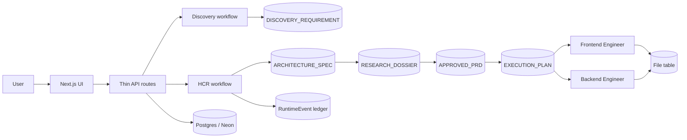
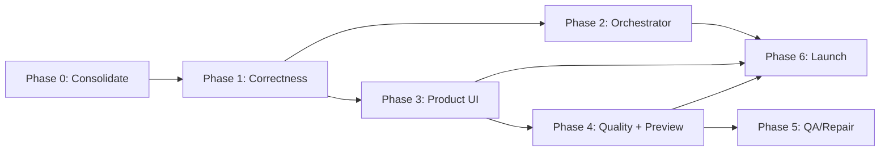

# Doable v1 — Build Completion Plan

The artifact-driven HCR runtime is largely built; the product UI, runtime correctness, one canonical orchestrator, and the preview/QA/deploy last mile are not. This plan consolidates the repo, hardens the runtime, ships a usable workspace, then closes the generation loop.

## Verdict

Doable already has the hard part: a working artifact-driven HCR runtime with six cognitive nodes, immutable versioned artifacts, runtime events, a discovery pipeline, and a completed Temporal full-graph implementation. What is missing is the **product** — a real user-facing workspace, a reliable end-to-end run, and the last mile (preview / QA / deploy).

There is also a release-hygiene problem. The public repo's `main` is at the Phase 5 + Temporal-pilot merge (`54d4507`), while the newest work is on `phase/hcr-context-engine` (`1567ede`, roughly 13k lines ahead, 2 commits unpushed). Local `origin/main` is stale. The current build is not what a visitor to `github.com/Maverick-sst/doable` sees.

## Health snapshot

| Check | Result |
| --- | --- |
| `bunx tsc --noEmit --incremental false` | Pass |
| `bun test` | 47 pass, 0 fail (3 pure suites) |
| `bun run lint` | 19 errors, 17 warnings |
| CI | None |
| Product UI | `app/page.tsx` is create-next-app boilerplate; `app/dashboard` is an API harness; `app/test/agent` is a dev console |
| Styling | Tailwind is **not loaded** — `app/layout.tsx` never imports `app/globals.css` |
| Secrets | No tracked `.env`; only `.env.example` is tracked (verified) |

## Architecture as built

Two orchestration paths exist today:

- **Inngest** is still the production path for `POST /api/projects/:id/chat`.
- **Temporal** is a side path via `POST /api/temporal/hcr`, with a full-graph workflow, coordinator port, heartbeats, and failure compensation already implemented.

That split is the largest source of duplicated logic.

## Document map

| Document | Covers | Status |
| --- | --- | --- |
| `PHASE_4_PRD.md` | Artifact system, discovery, single-node HCR, thin routes | Implemented |
| `PHASE_5.MD` | Six-node HCR graph, agent registry, artifact contracts, coordinator | Implemented |
| `JOB_6.MD` / `TEST_6.MD` | HCR inspection console and artifact validation dashboard | Partial, only as a dev test page |
| `d-2/hcr/*` | Inngest → Temporal migration map, verification, cutover, caveats | Implemented, side path |
| `d-3/agent_configuration/*` | Agent configuration and context-engine boundaries | Implemented, not fully wired into the executor |
| — | V1 product PRD, UI spec, preview/QA/deploy spec, launch runbook | **Missing** |

## What exists

- Prisma schema for `User`, `Project`, `File`, `Message`, `Workflow`, `Execution`, `Node`, `Artifact`, `RuntimeEvent`, `ProjectMemory`.
- Discovery conversation → `DISCOVERY_REQUIREMENT` artifact → project `PENDING`.
- Six-node HCR: `ARCHITECT → RESEARCH → PRD_REVIEWER → PLANNER → FRONTEND_ENG + BACKEND_ENG` in parallel.
- Zod validators for the four structured artifacts; path validation in `ExecutionPlanSchema`.
- Artifact versioning, `RuntimeEvent` emission, workflow/execution/node status tracking.
- Temporal workflow with per-node activities, 10–15 min timeouts, 3 retries, heartbeats, coordinator port, finalize, and failure compensation.
- Context engine boundary with retrievers and a pure assembler; agent-config boundary with catalog and resolver.
- Clerk auth, pgvector embedding pipeline, Neon/Prisma adapter.
- 47 passing unit tests covering the pure context/agent-config/temporal contracts.

## What is missing

| Area | Gap |
| --- | --- |
| Product UI | No landing page, app shell, project workspace, discovery chat UI, build timeline, artifact inspector, or file viewer for end users |
| Styling | Tailwind CSS never imported; pages render without the design system |
| Project identity | Project name is always `""`; dashboard sends name/description but the route strips them |
| Generation quality | No scaffold seeding, no app build/preview, no verification that generated code runs |
| Preview | No WebContainer/sandbox, no zip export, no generated-app deployment |
| QA/repair | `TEST_DESIGNER`, `QA`, `REPAIR` enum values exist but no nodes implement them |
| Reliability | No idempotency, no retry/cancel/resume, failed runs strand projects at `IN_PROGRESS` |
| Observability | Only runtime events and console logs; no structured logging, tracing, cost tracking, or metrics |
| Ops | No CI, no test DB harness, no worker deployment, no environment runbook |
| Docs | Root README is boilerplate; AGENTS.md is outdated (Next 15, old paths); no current-state architecture doc |

## P0 findings — fix before adding features

1. **Artifact retrieval crosses workflow boundaries.** `createArtifact` versions by `(projectId, workflowId, type)` (`src/runtime/artifacts/create-artifact.ts:17`), but retrieval reads the latest by `(projectId, type)` (`src/hcr/context-engine/retrievers/artifacts.ts:17`). A later workflow's version 1 can lose to an earlier workflow's version 3, so a new build can consume stale requirements. Decide on one scope (per-project versioning is the simplest) and add a unique constraint.
2. **Discovery is not gated by project status.** `app/api/projects/[id]/discovery/route.ts:24` only checks ownership, not `status === DISCOVERY`. Re-running discovery on a built project flips it back to `PENDING` in `completeDiscoveryWorkflow`.
3. **Failed runs strand the project.** Neither `lib/handleFailure.ts` nor Temporal `markHcrFailed` resets `Project.status`; the chat gate then refuses a retry forever without a manual DB edit.
4. **No idempotency.** Duplicate triggers, coordinator re-delivery, artifact creation, and FE/BE file writes can all duplicate state. There is no unique key on `(executionId, order, type)`, `Artifact.nodeId`, or tool-call ID.
5. **Tailwind is dead.** `app/layout.tsx` never imports `app/globals.css`; every Tailwind class in the harness pages is currently inert.
6. `.gitignore`** hides the wrong files.** It ignores `prisma/schema.prisma`, `prisma/migrations`, `README.md`, `scripts`, and `app/test` (`.gitignore:44-71`). Existing files are tracked, but **new migrations and docs will be silently omitted**.
7. **Prompt/content logging.** `app/api/projects/[id]/discovery/route.ts` and `src/cognition/discovery-agent.ts:72` log user prompts and raw LLM output. That violates the repo's own PII rule and leaks user content into logs.
8. **Tool schemas require **`projectId`** the model never receives.** `lib/tools.ts` marks `projectId` required in every tool, but it is not injected into context; `executeTool` ignores the argument and uses the server-side value anyway. Remove it from the model-facing schema.
9. **Structured nodes pay for embeddings they do not use.** `src/cognition/node-executor.ts` calls `getEmbeddings(prompt)` for every node, even when `includeVectorSearch` is false. An embedding outage can fail ARCHITECT/RESEARCH/PRD/PLANNER.
10. **Release state is confusing.** There are 15+ phase branches, dead `hcr-agent.ts` (trigger `chat/requested` has no sender), two failure writers, and a stale local `main`. Nothing in the repo tells a newcomer which path is canonical.

## P1 findings — fix during v1

- No Zod validation on `POST /chat`; only a `typeof prompt` check.
- Discovery artifact is not validated against a schema; malformed agent output can poison downstream context.
- `completeDiscoveryWorkflow` writes artifact, memory, project, node, execution, workflow, and events without a transaction.
- `createArtifact` is not transactional with its event write; a DB failure can leave an artifact without an event.
- `GET /api/projects/:id/status` returns the latest workflow even when it is a `DISCOVERY` workflow, which can confuse build polling.
- `DELETE /api/projects/:id` returns a JSON body with status 204.
- No pagination on project/file/message lists.
- No rate limiting, quota, token accounting, or per-project concurrency cap.
- `callLLM` has an `any`, no request timeout/abort, no model fallback, and no JSON response-format hint.
- `getEmbeddings` hardcodes a free model and 768 dimensions; no batching or retry.
- Inngest production keys/signing key and `NEXT_PUBLIC_APP_URL` are absent from `.env.example`.
- No `typecheck`/`test` scripts in `package.json`; no Node engine declaration.

## Proposed V1 definition

**V1 is a usable product, not the full autonomous vision.**

In scope:

- Sign up / sign in; project dashboard with real names and statuses.
- Create project (name, description, domain).
- Discovery chat → `DISCOVERY_REQUIREMENT` preview → explicit **Approve & Build**.
- Build workspace: live six-node timeline, artifact inspector, generated file tree, code viewer.
- Retry / cancel / resume; clear failure and empty states.
- Export generated project as a zip; optionally open a preview.
- Iteration: user feedback starts a new HCR run that reads the latest project artifacts and files.
- One canonical orchestrator, one failure path, CI, structured logs, usage limits.
- Deployed to production with a smoke-tested golden path.

Out of V1 (V1.1+):

- Automated QA/repair loop and sandboxed execution of generated apps.
- One-click deployment of the generated app to the user's own hosting.
- Teams/orgs, billing, Git integration, model router, real-time streaming, mobile.

## Roadmap

### Phase 0 — Consolidate the repo (1–2 days)

- Fetch remote; reconcile local `main` with `54d4507`; create a short-lived `v1/foundation` branch from the canonical commit.
- Merge/PR the current `phase/hcr-context-engine` work into `main` after review (or explicitly park it).
- Fix `.gitignore`; stop ignoring `prisma/`, `README.md`, `scripts`, `app/test`; keep `.env*` ignored.
- Move `d-2`/`d-3` decisions into `docs/`; commit or delete the untracked run JSON.
- Rewrite root `README.md`: architecture, setup, env, workflows, known gaps.
- Update `AGENTS.md`: Next 16, current paths, allowed commands, security rules.
- Import `globals.css` in `app/layout.tsx`; add the product shell.
- Fix lint errors or scope the dev harness out of lint; add `typecheck`, `test`, `lint` scripts.
- Add CI: install, typecheck, unit tests, lint, build (with safe dummy env).

**Exit:** A newcomer can clone, set env, run one command, and reach a styled page; CI is green; main reflects the latest code.

### Phase 1 — Runtime correctness (3–5 days)

- Fix artifact version scope and retrieval; add a migration and a unique constraint.
- Gate discovery by `DISCOVERY`; save the user message before the agent call; validate discovery output with Zod; wrap completion writes in a transaction.
- Make failures terminal and recoverable: project `FAILED` or back to `IDLE`, retry/cancel endpoints, stale-run sweeper.
- Add idempotency: trigger key or active-execution guard; coordinator dedup by `(executionId, order, type)`; artifact `nodeId` uniqueness; tool-call dedup.
- Remove `projectId` from model-facing tool schemas; validate tool arguments.
- Only fetch embeddings when vector search is enabled; add request timeouts and JSON response-format hints for structured nodes.
- Add structured logging with request/execution IDs; remove prompt and raw LLM logging.
- Add integration tests for artifact versioning, discovery gate, coordinator fan-out/finalize, and failure compensation.

**Exit:** A duplicate trigger cannot double-create; a failed run is visibly recoverable; a later build never reads an earlier build's artifact.

### Phase 2 — One orchestrator (2–3 days)

- Decide Temporal vs Inngest (see decision points).
- If Temporal: cut `POST /chat` over behind `HCR_ORCHESTRATOR`, keep Inngest one release for rollback, unify the failure writer, deploy the worker, add health checks and env validation.
- If Inngest: delete the Temporal side path and the duplicated contracts, keep the simpler ops story.
- Remove dead `hcr-agent.ts`, the `buildContext` compat wrapper, and the second failure writer.
- Record a full-graph run with evidence (IDs, artifacts, events, failure drill).

**Exit:** One code path starts a build; rollback is documented; no duplicated orchestration logic.

### Phase 3 — Product UI v1 (5–8 days)

- App shell, navigation, project list, empty states, error boundaries, loading states.
- Create-project flow with real name/description/domain.
- Discovery workspace: chat, streaming or polling, artifact summary, approve/build action.
- Build workspace: node timeline, status polling, artifact inspector, file tree, code viewer, logs.
- Retry/cancel/resume controls; clear status language.
- Responsive layout and accessible components; decide Tailwind + custom vs shadcn/Radix.

**Exit:** A first-time user can create a project, finish discovery, watch a build, inspect every artifact and file, and retry a failure without touching the test harness.

### Phase 4 — Generation quality and workspace (5–10 days)

- Seed a real scaffold (package.json, Vite/Next config, Tailwind, entry files) before FE/BE run, so generated output is runnable rather than fragments.
- Improve per-node prompts with examples and stricter JSON contracts; enforce schema at the provider boundary where possible.
- Add zip export and a preview path (decision point).
- Add iteration flow using the latest artifacts/files.
- Add token/cost tracking and per-project budgets.

**Exit:** A generated project can be downloaded and at least statically previewed; a second instruction produces a coherent diff, not a restart.

### Phase 5 — QA and repair (V1.1, 5–10 days)

- Implement `TEST_DESIGNER`, `QA`, `REPAIR` nodes; run build/tests in a sandbox; feed failures back into a bounded repair loop.
- Add artifact quality scoring and an evaluation dashboard.

**Exit:** The system can detect a broken generated app and attempt a bounded fix.

### Phase 6 — Launch readiness (3–5 days)

- Deploy app (Vercel), DB (Neon), auth (Clerk prod), orchestrator (Temporal Cloud or Inngest), worker.
- Add rate limiting, quotas, Sentry/OTel, alerts, backups, migration and incident runbooks.
- Add privacy/terms, license, and user docs.
- Run a golden-path smoke test and a failure drill in production.

**Exit:** A real user can complete the journey; failures alert; rollback and restore are documented.

## Ordering and dependencies

Phase 2 and Phase 3 can run in parallel once Phase 1 is done; they touch mostly disjoint files. Phase 4 depends on the UI because preview needs a surface. Phase 5 is explicitly V1.1 unless the definition of done includes verified generated apps.

## Verification strategy

- **Unit:** keep the current pure suites; add artifact-version and status-machine tests.
- **Integration:** Postgres test database or Neon branch; run discovery → HCR with a mocked LLM adapter; assert rows, artifacts, events, statuses.
- **Failure drills:** duplicate trigger, worker death mid-node, malformed JSON, embedding outage, Temporal unreachable, retry exhaustion.
- **E2E:** one Playwright journey against a seeded project; one real-LLM smoke run in a nightly job.
- **Cost:** record tokens and dollars per node per run; fail the nightly if it exceeds the budget.

## Risks

| Risk | Mitigation |
| --- | --- |
| Scope creep: "complete" means different things | Approve the V1 in/out list before coding |
| Temporal operational burden | Decide in Phase 2; keep Inngest fallback for one release |
| LLM nondeterminism / poor generated code | Seed scaffolds, validate artifacts, add QA/repair |
| DB migrations on live data | Additive migrations, backfill scripts, Neon branch rehearsal |
| Public repo and no CI | Phase 0 CI + secret scanning; no secrets in history (verified) |
| Cost blow-up from re-embedding and retries | Cache embeddings per node run, budget caps, model router later |

## Decision points — need your call

1. **V1 boundary:** Is V1 "generate + inspect + export/preview", or must it include automated QA/repair and deployment of the generated app?
2. **Orchestrator:** Finish the Temporal cutover (already implemented, better for long builds, more ops) or consolidate on Inngest for V1 and archive Temporal?
3. **Preview runtime:** WebContainer (client-side, cheap, React/Vite friendly), remote sandbox (E2B/Daytona/Fly, real Node, more work), or zip export only for V1?
4. **Product shape:** Personal single-user tool, or SaaS with teams/orgs/billing? The current schema is single-user.
5. **UI approach:** Tailwind + small custom primitives, or add shadcn/Radix and a component library?
6. **Model/budget:** One model for all nodes for V1, or a per-node model router with a hard cost ceiling?

## First three days if approved

1. **Day 1:** Fetch/merge, pick canonical branch, fix `.gitignore` and `globals.css`, rewrite README/AGENTS, add scripts + CI skeleton, get lint green.
2. **Day 2:** Artifact version/retrieval fix with migration and tests; discovery status gate + Zod validation + transaction; failure-to-`FAILED`/retry path.
3. **Day 3:** Orchestrator decision spike and cutover plan; idempotency design; write the V1 product PRD (screens, states, API contracts, acceptance criteria).

## Key references

- `src/runtime/artifacts/create-artifact.ts`
- `src/hcr/context-engine/retrievers/artifacts.ts`
- `app/api/projects/[id]/discovery/route.ts`
- `app/api/projects/[id]/chat/route.ts`
- `app/inngest/functions/workflow-coordinator.ts`
- `src/temporal/workflows/hcrWorkflow.ts`
- `src/cognition/node-executor.ts`
- `lib/tool-executor.ts`
- `lib/tools.ts`
- `prisma/schema.prisma`
- `.gitignore`
- `app/layout.tsx`
- `PHASE_4_PRD.md`, `PHASE_5.MD`, `TEST_6.MD`
- `d-2/hcr/HCR_KNOWN_CAVEATS.md`
- `d-3/agent_configuration/`
